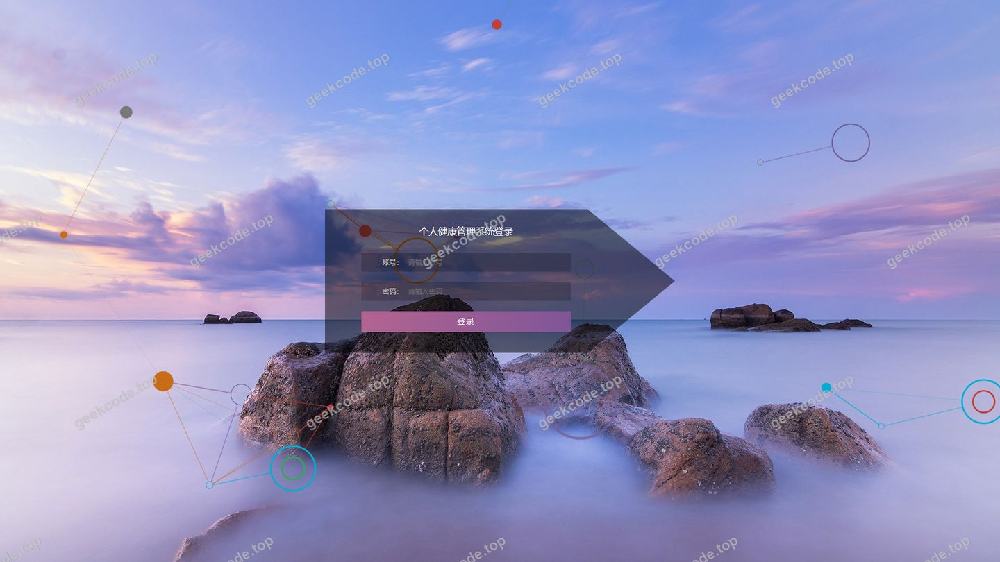
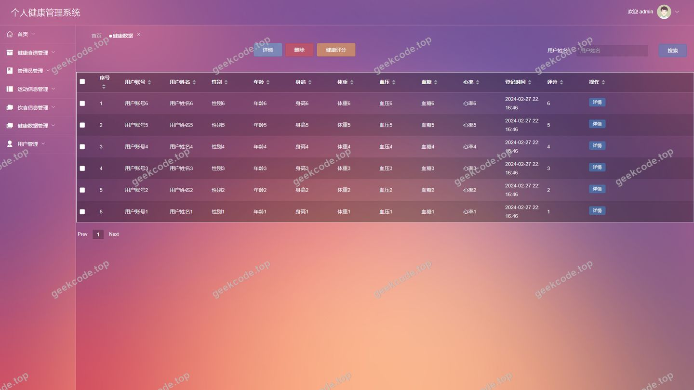
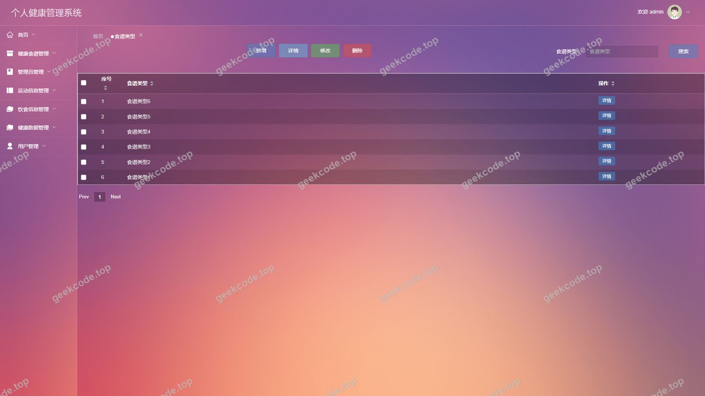
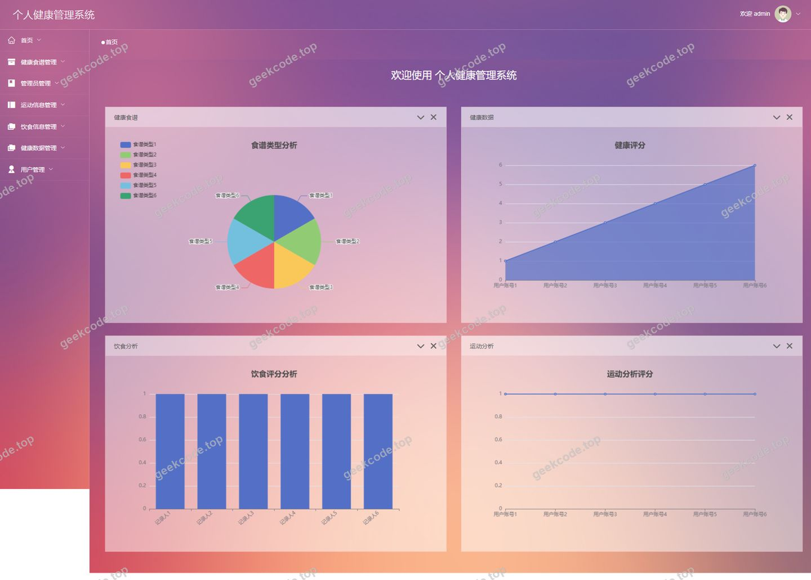
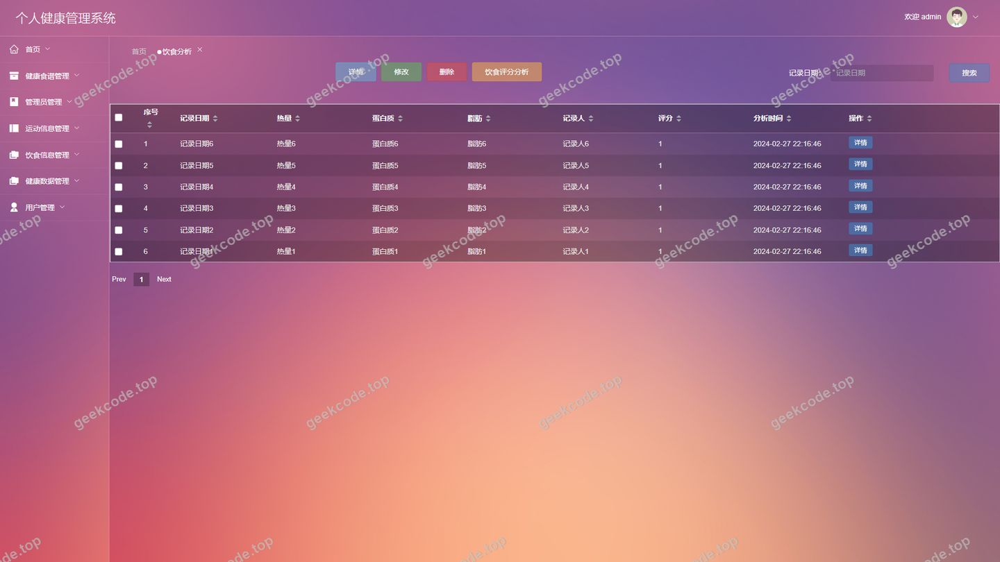
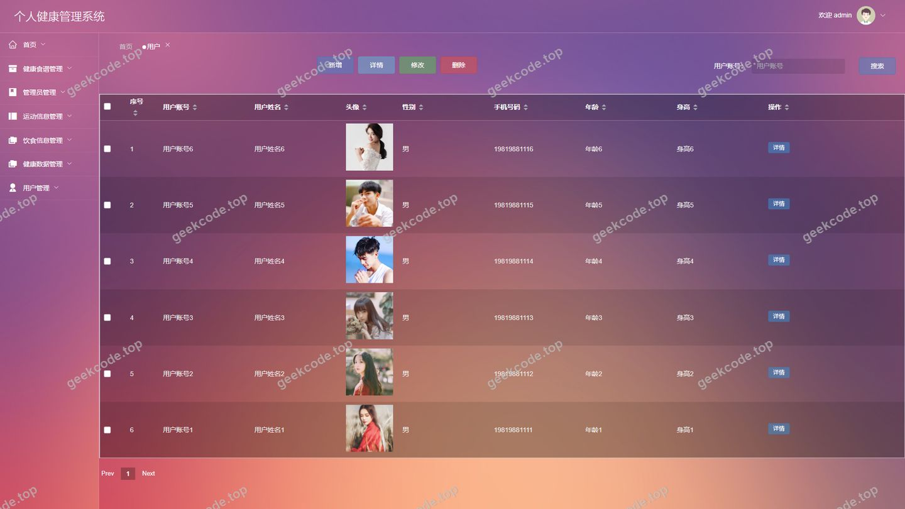
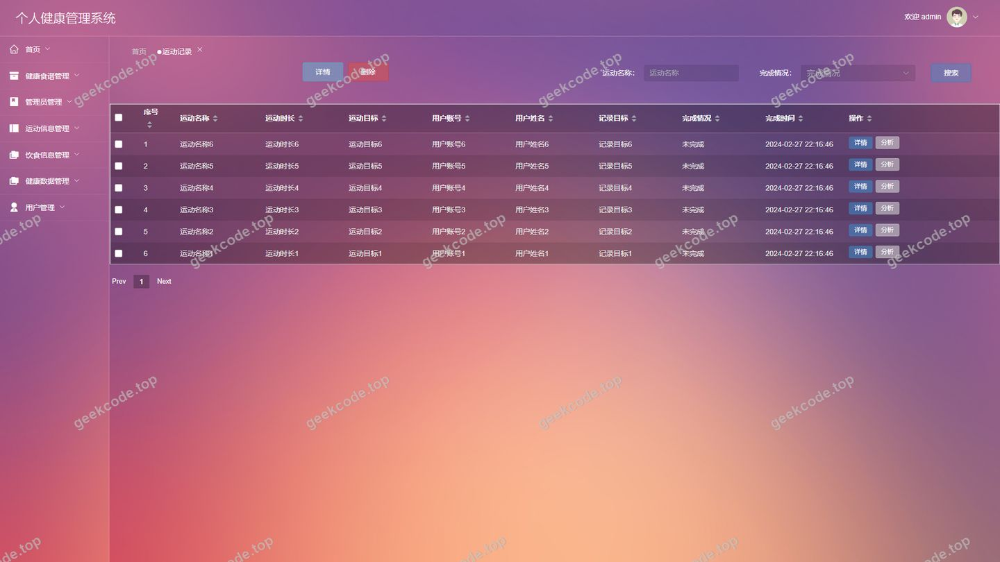
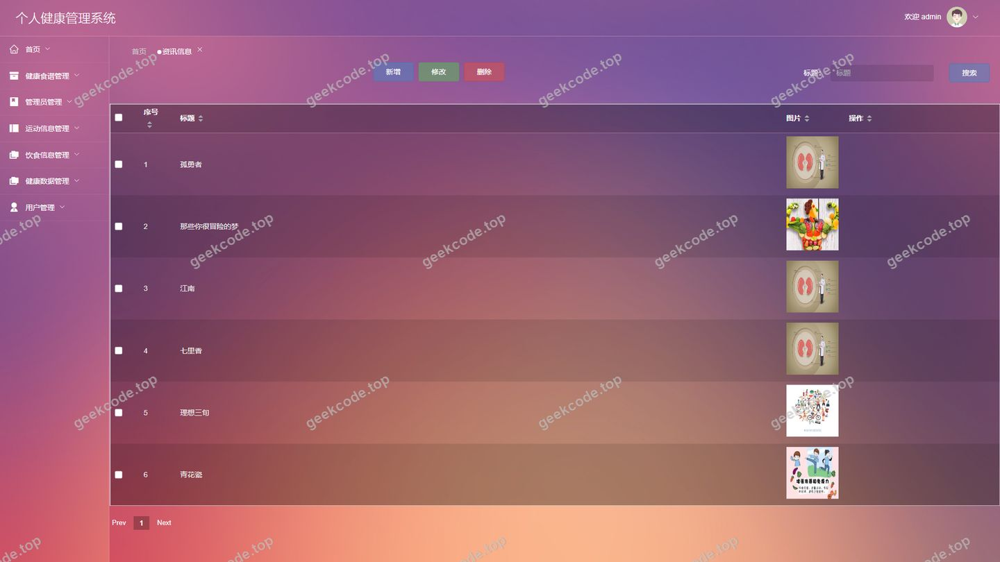

# 个人健康管理系统

> 🎓 **计算机毕业设计 · 个人健康管理系统**
>
> 本仓库只放**项目介绍 + 运行截图**（截图是站点带水印的原图，存在仓库 `images/` 里）。
>
> 👉 **完整可运行源码 / 数据库脚本 / 部署文档：[点我获取](https://geekcode.top/archives/%E4%B8%AA%E4%BA%BA%E5%81%A5%E5%BA%B7%E7%AE%A1%E7%90%86%E7%B3%BB%E7%BB%9F?utm_source=github)**
>
> 💬 咨询微信：**ir9372**　|　🌐 更多项目：[极客代码 geekcode.top](https://geekcode.top/?utm_source=github)
>
> 📌 项目详情页：<https://geekcode.top/archives/%E4%B8%AA%E4%BA%BA%E5%81%A5%E5%BA%B7%E7%AE%A1%E7%90%86%E7%B3%BB%E7%BB%9F?utm_source=github>

<table><td width="230" align="center"> <b>扫码加微信 ir9372</b></td><td valign="middle">📦 源码 = 项目介绍 + 全部运行截图 + 数据库 + 部署文档 👉 点上方任意截图，直接跳到 <b>极客代码 geekcode.top</b> 详情页</td></table>

---

<h1>个人健康管理系统</h1>
<h2>一、项目概述</h2>

本项目为“健康食谱与运动管理系统”，旨在通过数字化手段帮助用户科学规划饮食与运动。系统采用Spring Boot后端框架，结合MyBatis-Plus进行数据持久化，使用Shiro实现安全认证与授权。核心功能分为前台用户端与后台管理端：前台允许用户注册登录，浏览和收藏健康食谱，制定运动计划，记录日常饮食与运动数据，并生成相应的健康分析报告；后台则供管理员全面管理用户信息、食谱内容、分类标签、各类记录数据、系统配置及新闻资讯。该系统适用于关注个人健康管理的人群，提供从知识获取到行为记录再到数据分析的全流程服务。

<h2>二、系统角色与功能权限</h2>
<h3>普通用户</h3>
<ul>
<li><strong>功能权限</strong>：注册与登录、个人资料维护、浏览健康食谱并收藏、制定与管理个人运动计划、记录每日运动情况、记录每日饮食情况、录入身体指标等健康数据、查看基于记录的饮食与运动分析报告、阅读平台发布的健康资讯</li>
<li><strong>前台访问</strong>：可登录前台用户端</li>
<li><strong>注册</strong>：支持自主注册</li>
</ul>
<h3>管理员</h3>
<ul>
<li><strong>功能权限</strong>：后台登录与权限控制、全量用户信息管理与审核、健康食谱内容的增删改查、食谱分类标签的管理、运动计划、记录及分析数据的监控与维护、饮食记录与分析数据的监控与维护、健康数据的统计与管理、收藏列表的查询与管理、系统基础参数（如轮播图）配置、前台新闻公告的发布与管理</li>
<li><strong>后台访问</strong>：可登录后台管理端</li>
</ul>
<h2>三、前台用户端功能</h2>
<ul>
<li>用户注册</li>
<li>用户信息管理</li>
<li>健康食谱浏览</li>
<li>食谱详情查看</li>
<li>食谱收藏</li>
<li>运动计划管理</li>
<li>运动记录录入</li>
<li>饮食记录录入</li>
<li>健康数据录入</li>
<li>饮食分析查看</li>
<li>运动分析查看</li>
<li>新闻资讯浏览</li>
</ul>
<h2>四、后台管理端功能</h2>
<ul>
<li>用户管理</li>
<li>健康食谱管理</li>
<li>食谱类型管理</li>
<li>运动计划管理</li>
<li>运动记录管理</li>
<li>饮食记录管理</li>
<li>健康数据管理</li>
<li>饮食分析管理</li>
<li>运动分析管理</li>
<li>收藏信息管理</li>
<li>系统配置管理</li>
<li>新闻公告管理</li>
</ul>
<h2>五、技术特性</h2>
<ul>
<li>前后端分离架构，前端独立部署</li>
<li>使用 MyBatis-Plus 简化数据访问层开发</li>
<li>集成 Shiro 权限框架实现角色权限控制</li>
</ul>
<h2>六、功能模块截图</h2>
<h3>后台管理端</h3>
<h4>后台-登录页</h4>

<h4>后台-健康数据</h4>

<h4>后台-食谱类型</h4>

<h4>页面-首页</h4>

<h4>后台首页</h4>

<h4>后台-饮食分析</h4>

<h4>后台-用户</h4>

<h4>后台-运动记录</h4>

<h4>后台-资讯信息</h4>

---

## 获取完整源码

| 项目 | 说明 |
| --- | --- |
| 项目名 | 个人健康管理系统 |
| 运行截图 | 本文 9 张（站点带水印原图，仓库 `images/` 目录） |
| 完整源码 | [https://geekcode.top/archives/%E4%B8%AA%E4%BA%BA%E5%81%A5%E5%BA%B7%E7%AE%A1%E7%90%86%E7%B3%BB%E7%BB%9F?utm_source=github](https://geekcode.top/archives/%E4%B8%AA%E4%BA%BA%E5%81%A5%E5%BA%B7%E7%AE%A1%E7%90%86%E7%B3%BB%E7%BB%9F?utm_source=github) |
| 咨询微信 | **ir9372**（备注：jingpin-yuanma） |
| 更多项目 | [极客代码 geekcode.top](https://geekcode.top/?utm_source=github) |

> 需要源码、部署、改配置、跑不起来等问题，加微信 ir9372 沟通，说明项目名即可。
